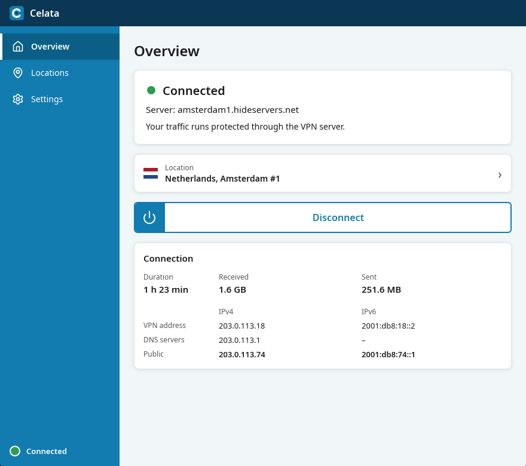
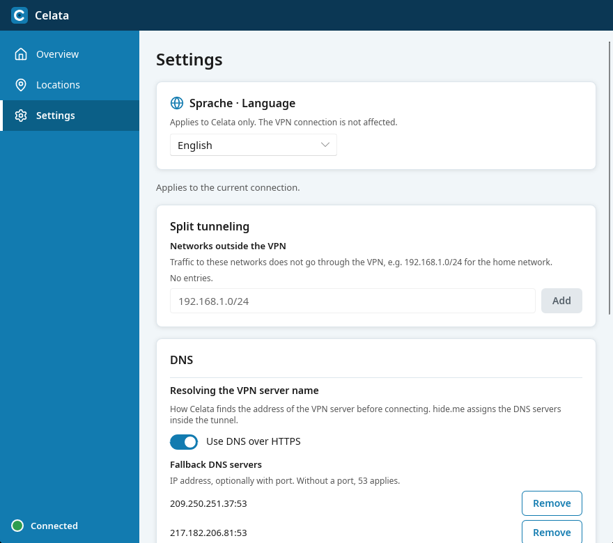

# Celata

Celata is a graphical interface for the hide.me VPN command-line client on Linux.



**Unofficial. Not affiliated with, endorsed by, or supported by hide.me.**
Celata is only the graphical interface; the VPN itself is the hide.me command-line client, which you
install separately.

## Status

Version 0.8.1 is the first public version.

- The code has been through a structured self-review with automated tools and an AI assistant.
- Celata has been used day to day on one system only (Fedora 44 family with KDE Plasma on Wayland). On the
  other systems it has been built, installed and started, but not used with a real VPN connection. See
  [Tested on](#tested-on).

Celata comes with ABSOLUTELY NO WARRANTY, to the extent permitted by applicable law. See [LICENSE](LICENSE).

## Internet blocked? Emergency exit

The kill switch of the hide.me client blocks all traffic outside the VPN. If the VPN fails, or if you
block the internet yourself, nothing gets through until the block is lifted. Read this before you need it,
because you cannot look it up without internet.

**In Celata:** move the mouse onto the red field at the right end of the main button. The whole button
turns red and reads "Unblock internet". Click it and confirm.

**If Celata does not react or is not running**, stop the service in a terminal. This ends the connection
and removes the block:

```bash
sudo systemctl stop celata-hide.me.service
```

## Features

- See at a glance whether the VPN is connected, to which location, for how long, and with which addresses
- Connect and disconnect with one button
- Choose a location by country and city, with search and a "Free only" filter; a separate tab lists
  streaming servers
- Switch to another location while connected; the internet stays blocked in between instead of unprotected
- Block the internet on purpose and lift the block again
- Change the settings of the hide.me service: split tunneling, DNS, connection and advanced values
- A hint when DNS requests can bypass the VPN on your system
- English and German, switchable without a restart
- Runs without administrator rights

| Locations | Settings |
|---|---|
|  |  |

## Requirements

- Linux on x86_64 with systemd
- A Wayland session. X11 is enabled but untested; use it at your own risk.
- A hide.me account
- The [hide.me command-line client](https://github.com/eventure/hide.client.linux), version 0.9.14, installed
  and provided with an Access-Token as described in its README. Celata does not include the client. Celata
  0.8.1 is tested with this version only and warns if the service reports another one.

## Tested on

| System | Built | Installed | Started | Used day to day |
|---|---|---|---|---|
| Fedora 44 | yes | yes | yes (Wayland) | yes (Nobara 44, KDE Plasma) |
| Fedora 45 | yes | yes | yes (Wayland) | no |
| Debian 13 | yes | yes | yes (Wayland) | no |
| Ubuntu 24.04 LTS | yes | yes | yes (Wayland) | no |
| Ubuntu 26.04 LTS | yes | yes | yes (Wayland) | no |
| Ubuntu 26.10 | yes | yes | yes (Wayland) | no |
| Arch Linux | yes | yes | yes (Wayland) | no |

"Installed" and "Started" mean: the package was installed in a fresh container of that system and the
window appeared with text and icons. No connection was made there. GNOME as a desktop has not been tested.

## Install

Download the file for your system and `SHA256SUMS` from the
[releases page](https://github.com/derHouwer/celata/releases) into one directory. Check the download
first:

```bash
sha256sum -c SHA256SUMS --ignore-missing
```

Every file you downloaded must be reported as `OK`.

Installing never starts the service, never connects, and adds no user to any group.

### Debian and Ubuntu

For Debian 13 and Ubuntu 24.04 or newer:

```bash
sudo apt install ./celata_0.8.1-1_amd64.deb
```

### Fedora

For Fedora 44 and 45 (one package for both):

```bash
sudo dnf install ./celata-0.8.1-1.x86_64.rpm
```

`dnf` warns that it skipped the OpenPGP checks for this package. That is expected: the package is not
signed, which is why the check with `SHA256SUMS` above matters.

### Arch Linux

Download `PKGBUILD` and `celata.install` into an empty directory and build the package there. `makepkg`
downloads the source code and verifies its checksums.

```bash
makepkg -si
```

The package expects the hide.me client from the AUR package `hide-client`. If you installed the client with
its own installer into `/opt/hide.me` instead, see [Troubleshooting](#troubleshooting).

### Other systems

See [docs/manual-setup.md](docs/manual-setup.md).

## Set up after installing

Only members of the group `celata` may control the service. Add yourself, then **log out and back in
once**; the group applies only to new sessions.

```bash
sudo usermod -aG celata "$USER"
```

Start the service:

```bash
sudo systemctl start celata-hide.me.service
```

Started this way, the service runs until the next shutdown. The service only waits for Celata. It never
connects on its own.

If you want the service to start with the computer instead, enable it once:

```bash
sudo systemctl enable --now celata-hide.me.service
```

Then the control socket is reachable for the group `celata` all the time, not only while you use Celata;
see [Security](#security). To undo it:

```bash
sudo systemctl disable --now celata-hide.me.service
```

Now start Celata from the application menu or with `celata`.

If your user may not use `sudo` (a default Debian installation, for example), open a root shell with
`su -`, run the commands there without the word `sudo`, and write your user name instead of `"$USER"`.

## First steps

1. **Connect:** open "Locations", choose a location, and press "Connect VPN" in the overview. A double
   click on a location connects, too.
2. **Switch:** while connected, choose another location and connect to it. Celata disconnects, keeps the
   internet blocked in between, and connects to the new location. If the new location fails, it returns to
   the previous one.
3. **Disconnect:** press the main button again.
4. **Block the internet:** move the mouse onto the red field at the right end of the main button and click
   "Block internet". Nothing gets through until you connect or lift the block.
5. **Lift the block:** the same red field now reads "Unblock internet".

When you close the window while connected, Celata asks whether to disconnect. The VPN does not depend on
the window: if you leave it connected, it stays connected.

## DNS leaks

On systems that resolve names through systemd-resolved (Ubuntu and Fedora do so by default), name lookups
can travel past the VPN while you are connected. Celata shows a hint in the overview when it recognizes
such a system. How to check your own system and what you can do about it is described in
[docs/dns-leak.md](docs/dns-leak.md).

## Known limitations

- **Filters are hidden.** Version 0.9.14 of the hide.me client cannot apply its filters (ads, trackers,
  malware and so on) in service mode. Celata hides them until a newer client fixes this.
- **A block Celata cannot see.** Celata recognizes a blocked internet connection by reading the routing
  table with `ip`. If that fails, Celata treats the internet as free and shows no warning.
- **A wrong location in a rare case.** If you connect while the internet is blocked and the name of the new
  server cannot be resolved, the hide.me client silently connects to the previous server, and Celata shows
  the new name. Your traffic goes through the VPN either way.
- **The group `celata`.** Every program running under the account of a member of the group `celata` can
  control the hide.me service, read its configuration, including the Access-Token, and make the service
  overwrite files in `/etc`. See [SECURITY.md](SECURITY.md).
- **X11 is untested.** Celata starts in an X11 session, but nothing beyond that has been checked.
- **Limited testing.** See [Status](#status) and [Tested on](#tested-on).
- **The DNS hint is a hint.** It does not measure a leak and does not recognize every setup. No hint does
  not mean that your lookups are safe.
- **No automatic updates.** Celata is not in a package repository yet. To learn about new versions, including
  security fixes, watch this repository: "Watch" → "Custom" → "Releases".
- **Dialogs and the tab key.** While a dialog is open, the tab key also reaches buttons behind it.

## Updating and uninstalling

**Updating:** download the new package and install it the same way as the first time. A running service
keeps running and is not restarted.

**Uninstalling** stops and disables the service, which also ends a connection and lifts a block:

```bash
sudo apt remove celata        # Debian and Ubuntu
sudo dnf remove celata        # Fedora
sudo pacman -R celata         # Arch Linux
```

The group and your own files stay. To remove them as well:

```bash
sudo groupdel celata
rm -r ~/.config/celata ~/.cache/celata
```

## Troubleshooting

**"Service unavailable"**
The service is not running. Start it with `sudo systemctl start celata-hide.me.service`. If it does not stay
running, look at its state:

```bash
systemctl status celata-hide.me.service
```

`status=200/CHDIR` or `status=203/EXEC` means that the hide.me client is not where the service expects it
(`/opt/hide.me` in the Debian, Ubuntu and Fedora packages; `/usr/bin/hide.me` and `/etc/hide.me` in the
Arch package). After fixing the cause: `sudo systemctl restart celata-hide.me.service`.

**The client is in `/opt/hide.me` on Arch Linux**
Run `sudo systemctl edit celata-hide.me.service`, enter the following lines, save, and start the service
again:

```ini
[Service]
WorkingDirectory=/opt/hide.me
ExecStart=
ExecStart=/opt/hide.me/hide.me --caddr /run/hide.me/control.sock service
ReadWritePaths=
ReadWritePaths=/opt/hide.me /etc/resolv.conf -/run/systemd/resolve
```

**"No permission"**
Your account is not in the group `celata`, or you have not logged in again since you added it. Check with
`id -nG`; the list must contain `celata`.

**The window does not appear**
Start `celata` in a terminal and read the message. "Celata needs a graphical session" means that neither a
Wayland nor an X11 session was found.

**Celata warns about the version of the hide.me client**
Celata 0.8.1 is tested with version 0.9.14 only. With another version, settings may be ignored silently.

**The service log**

```bash
sudo journalctl -u celata-hide.me.service
```

Without `sudo`, many systems show an ordinary user no entries of system services. The log can contain
addresses and connection data. Remove them before you share it.

## Building from source

You need Rust 1.92 or newer and the development files of fontconfig.

```bash
cargo build --release --locked
```

The program is `target/release/celata`. Setting up the service and the group by hand is described in
[docs/manual-setup.md](docs/manual-setup.md), building the packages in
[docs/packaging.md](docs/packaging.md), and the layout of the code in
[docs/ARCHITECTURE.md](docs/ARCHITECTURE.md).

## Security

Please report security problems privately, as described in [SECURITY.md](SECURITY.md). That file also
explains what the group `celata` means for the security of your system.

## Feedback

Bug reports, ideas for new features and security concerns are welcome. See
[CONTRIBUTING.md](CONTRIBUTING.md) and the [Code of Conduct](CODE_OF_CONDUCT.md).

## License and credits

Celata is free software, licensed under the GNU General Public License, version 3 only
(GPL-3.0-only). See [LICENSE](LICENSE).

- The interface is built with [Slint](https://slint.dev), used under GPL-3.0-only.
- Country flags: [flag-icons](https://github.com/lipis/flag-icons) 7.6.0, MIT.
- Icons: [Lucide](https://lucide.dev) 1.70.0, ISC. The Celata logo is an original drawing.
- All third-party components with their licenses: [THIRD-PARTY-LICENSES.md](THIRD-PARTY-LICENSES.md).

Celata contains no code, logos or graphics of hide.me. "hide.me" is the name of a product of its owner and
is used here only to say what Celata works with.

## Support

If Celata is useful to you, you can support its development on [Ko-fi](https://ko-fi.com/derhauer).
