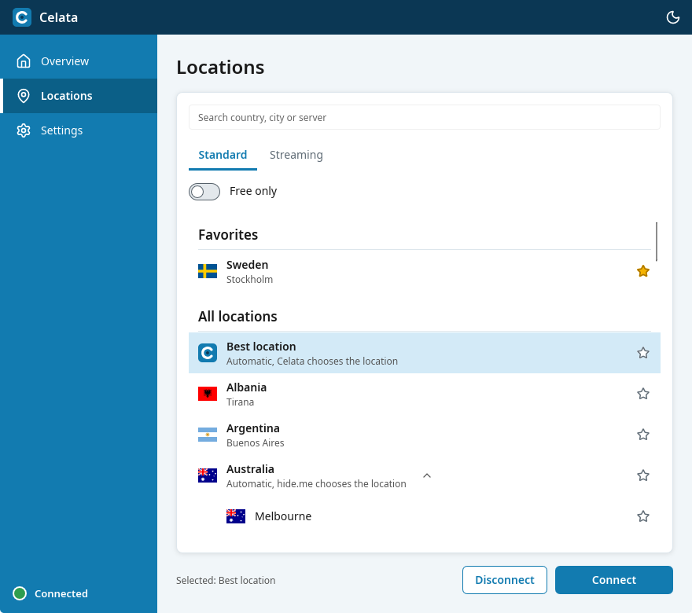

# Celata

Celata is a graphical interface for the hide.me VPN command-line client on Linux.


**Unofficial. Not affiliated with, endorsed by, or supported by hide.me.**
Celata is only the graphical interface; the VPN itself is the hide.me command-line client, which you
install separately.

## Status

Version 0.9.0 is the second public version, after 0.8.1. It adds the tray icon with its menu, favorite
locations, "Best location", a dark appearance, the start of the service by Celata and the setup script; see the
[changelog](CHANGELOG.md). If you use 0.8.1, see [Updating from 0.8.1](#updating-from-081).

- Version 0.8.1 has been through a structured self-review of all hand-written code; the changes since then
  (version 0.9.0) have been through a security review of their own, both with automated tools and an AI
  assistant.
- Celata has been used day to day on one system only (Fedora 44 family with KDE Plasma on Wayland). On the
  other systems it has been built, installed and started, but not used with a real VPN connection. See
  [Tested on](#tested-on).

Celata comes with ABSOLUTELY NO WARRANTY, to the extent permitted by applicable law. See [LICENSE](LICENSE).

## Internet blocked? Emergency exit

The kill switch of the hide.me client blocks all traffic outside the VPN. If the VPN fails, or if you
block the internet yourself, nothing gets through until the block is lifted. Read this before you need it,
because you cannot look it up without internet.

**In Celata:** move the mouse onto the red field at the right end of the main button. The whole button
turns red and reads "Unblock internet". Click it and confirm.

**Without the window:** right-click the Celata icon in the system tray and choose "Unblock internet", or run
this in a terminal (no administrator rights needed while the service runs):

```bash
celata --unblock
```

**If Celata does not react or is not running**, stop the service in a terminal. This ends the connection
and removes the block:

```bash
sudo systemctl stop celata-hide.me.service
```

## Features

- See at a glance whether the VPN is connected, to which location, for how long, and with which addresses
- Connect and disconnect with one button
- See the state in colour, at the main button and with an icon in the system tray: blue when not connected,
  green when connected, red when the internet is blocked
- Choose a location by country and city, with search and a "Free only" filter; countries with several
  locations are folded and open with an arrow; a separate tab lists streaming servers
- "Best location" (marked with the Celata logo) is preselected: it connects to the nearest location by the
  time zone of your computer, or by the country of the system language if the time zone has no place. Nothing
  leaves your computer to find it
- Mark favorite locations with a star: they stand at the top of the list and in "Favorite locations" on the
  overview
- Celata starts the hide.me service itself when it is not running; it never connects on its own
- Switch to another location while connected; the internet stays blocked in between instead of unprotected
- Block the internet on purpose and lift the block again
- A menu at the icon in the system tray (right click): the state, connect and disconnect, "Connect to best
  location", block or unblock the internet, your favorites and all locations sorted by continent, "About Celata"
  and "Quit". A left click brings the window back
- Desktop notifications when the connection changes while the window is not in front (can be switched off)
- Optionally keeps running in the system tray after closing the window, and optionally starts at login without
  connecting
- Starting Celata a second time brings the running window to the front instead of opening another one
- `celata --unblock` lifts a block from a terminal, without the window
- An optional check for new versions, off by default (see [Privacy of the version check](#privacy-of-the-version-check))
- Change the settings of the hide.me service: split tunneling, DNS, connection and advanced values
- A hint when DNS requests can bypass the VPN on your system
- English and German, switchable without a restart
- A light and a dark appearance: the button at the right end of the top bar (a moon or a sun) switches at once, and Celata remembers the choice; it starts light
- Runs without administrator rights

| Locations | Settings |
|---|---|
|  |  |

## Requirements

- Linux on x86_64 with systemd
- A Wayland session. X11 is enabled but untested; use it at your own risk.
- A hide.me account
- The [hide.me command-line client](https://github.com/eventure/hide.client.linux), version 0.9.14, installed
  and provided with an Access-Token as described in its README. Celata does not include the client. Celata
  0.9.0 is tested with this version only and warns if the service reports another one.

## Tested on

| System | Built | Installed | Started | Used day to day |
|---|---|---|---|---|
| Fedora 44 | yes | yes | yes (Wayland) | yes (Nobara 44, KDE Plasma) |
| Fedora 45 | yes | yes | yes (Wayland) | no |
| Debian 13 | yes | yes | yes (Wayland) | no |
| Ubuntu 24.04 LTS | yes | yes | yes (Wayland) | no |
| Ubuntu 26.04 LTS | yes | yes | yes (Wayland) | no |
| Ubuntu 26.10 | yes | yes | yes (Wayland) | no |
| Linux Mint 22 | – (uses the Ubuntu 24.04 package) | yes¹ | yes¹ (Wayland) | no |
| Arch Linux | yes | yes | yes (Wayland) | no |

"Installed" and "Started" mean: the package was installed in a fresh container of that system and the
window appeared with text and icons. No connection was made there. GNOME as a desktop has not been tested.

¹ In a container image of Ubuntu 24.04 with the Linux Mint 22 package sources and the `os-release` file of
Linux Mint 22, not on a full Mint installation.

The setup script (see [Install](#install)) was run in a fresh container of each of these systems, with a
placeholder in place of the hide.me client. Derivatives of these systems (for example Pop!_OS, Zorin OS,
Manjaro) can be set up with the script, but they are not tested.

Updating from 0.8.1 was tested in a fresh container of Ubuntu 24.04, Fedora 44 and Arch Linux, both with the
package manager and with the setup script: the settings file of 0.8.1, the group `celata` and a running service
(with a placeholder in place of the hide.me client) stayed as they were, and the rule for polkit came with the
package. A setup by hand was updated in a container of Fedora 44 with the command in
[Updating from 0.8.1](#updating-from-081).

## Install

There are two ways: the setup script, which does the steps for you, and the package of your system, which
you install yourself. Both start with the same check of the downloaded files.

### With the setup script

Download `celata-setup.sh` and `SHA256SUMS` from the
[releases page](https://github.com/derHouwer/celata/releases) into one directory. Check the download first:

```bash
sha256sum -c SHA256SUMS --ignore-missing
```

Every file you downloaded must be reported as `OK`. Then run the script:

```bash
bash celata-setup.sh
```

The script recognizes your system, looks for the hide.me client, installs the Celata package of the same
version with the package manager of your system, and adds you to the group `celata`. It shows a plan first
and asks before it changes anything; `--yes` answers the questions about the plan and the group in advance.
If the package file is not next to the script, the script downloads it from the releases page. It checks
every file against `SHA256SUMS` before it uses it, and it uses `sudo` for single commands only. If the
client lies somewhere else than the package expects, the script adds a drop-in file for the service.

The script does not install or change the hide.me client (install it first, see
[Requirements](#requirements)), does not touch DNS settings, does not start the service, does not connect and
does not block the internet. It warns about a likely DNS leak and about a missing tray, and it leaves a
setup made by hand untouched.

More options:

- `bash celata-setup.sh --check` shows what is in place and what is missing, and changes nothing.
- `bash celata-setup.sh --dry-run` shows what would be done, with the exact commands, and changes nothing.
- `bash celata-setup.sh --uninstall` removes what the script set up, after asking. It stops the service,
  which ends a connection and lifts a block.

If your user may not use `sudo` (a default Debian installation, for example), open a root shell with
`su -` and run `bash /path/to/celata-setup.sh --user <name>` there, with your user name.

### With a package by hand

Download the file for your system and `SHA256SUMS` as above and check them. Installing a package never starts
the service, never connects, and adds no user to any group.

#### Debian, Ubuntu and Linux Mint

For Debian 13, Ubuntu 24.04 or newer, and Linux Mint 22:

```bash
sudo apt install ./celata_0.9.0-1_amd64.deb
```

#### Fedora

For Fedora 44 and 45 (one package for both):

```bash
sudo dnf install ./celata-0.9.0-1.x86_64.rpm
```

`dnf` warns that it skipped the OpenPGP checks for this package. That is expected: the package is not
signed, which is why the check with `SHA256SUMS` above matters.

#### Arch Linux

Download `PKGBUILD` and `celata.install` into an empty directory and build the package there. `makepkg`
downloads the source code and verifies its checksums.

```bash
makepkg -si
```

The package expects the hide.me client from the AUR package `hide-client`. If you installed the client with
its own installer into `/opt/hide.me` instead, see [Troubleshooting](#troubleshooting).

### Other systems

See [docs/manual-setup.md](docs/manual-setup.md).

## Set up after installing

The setup script does this for you; this section is for installing a package by hand.

Only members of the group `celata` may control the service. Add yourself, then **log out and back in
once**; the group applies only to new sessions.

```bash
sudo usermod -aG celata "$USER"
```

You do not need to start the service yourself. The package brings a rule for polkit that lets members of the
group `celata` start this one service without a password, in a session directly at this computer. Celata starts
the service when it is not running: at every start of Celata, and when you connect after the service was
stopped. The service only waits for Celata; Celata never connects on its own.

If the service should start with the computer instead, enable it once:

```bash
sudo systemctl enable --now celata-hide.me.service
```

Then the control socket is reachable for the group `celata` all the time, not only while you use Celata;
see [Security](#security). To undo it:

```bash
sudo systemctl disable --now celata-hide.me.service
```

Without the rule (for example in a session over the network), Celata shows the button "Start service", which
asks for the administrator password. You can also start the service by hand:
`sudo systemctl start celata-hide.me.service`.

Now start Celata from the application menu or with `celata`.

If your user may not use `sudo` (a default Debian installation, for example), open a root shell with
`su -`, run the commands there without the word `sudo`, and write your user name instead of `"$USER"`.

## First steps

1. **Connect:** press "Connect VPN" in the overview. "Best location" is preselected and picks the nearest
   location. To choose one yourself, open "Locations", choose a location, and press "Connect VPN". A double
   click on a location connects, too.
2. **Switch:** while connected, choose another location and connect to it. Celata disconnects, keeps the
   internet blocked in between, and connects to the new location. If the new location fails, it returns to
   the previous one.
3. **Disconnect:** press the main button again.
4. **Block the internet:** move the mouse onto the red field at the right end of the main button and click
   "Block internet". Nothing gets through until you connect or lift the block.
5. **Lift the block:** the same red field now reads "Unblock internet".

When you close the window while connected, Celata asks whether to disconnect. The VPN does not depend on
the window: if you leave it connected, it stays connected.

**The icon in the system tray:** a right click opens a menu with the same actions as the main button, your
favorites and all locations, sorted by continent. The connected location and its continent are marked with ✓. With "Keep running after closing" on
(Settings → Application), closing the window leaves Celata running in the system tray; quit it from the
menu. Without a system tray, closing always quits Celata. "Start at login" starts Celata after you log in; it
never connects by itself.

**In a terminal:** `celata --help` lists the options: `--version` and `--unblock`.

## Privacy of the version check

"Check for new versions" (Settings → Application) is off by default. When you switch it on, Celata asks
GitHub at start and once a day which release of Celata is the newest, at
`https://api.github.com/repos/derHouwer/celata/releases/latest`. Without VPN, GitHub sees your public address
and that you use Celata. Celata never checks while the internet is blocked, never downloads or installs
anything, and only shows a hint with a link to the releases page.

## DNS leaks

On systems that resolve names through systemd-resolved (Ubuntu and Fedora do so by default), name lookups
can travel past the VPN while you are connected. Celata shows a hint in the overview when it recognizes
such a system. How to check your own system and what you can do about it is described in
[docs/dns-leak.md](docs/dns-leak.md).

## Known limitations

- **Filters are hidden.** Version 0.9.14 of the hide.me client cannot apply its filters (ads, trackers,
  malware and so on) in service mode. Celata hides them until a newer client fixes this.
- **A block Celata cannot see.** Celata recognizes a blocked internet connection by reading the routing
  table with `ip`. If that fails, Celata treats the internet as free and shows no warning.
- **A wrong location in a rare case.** If you connect while the internet is blocked and the name of the new
  server cannot be resolved, the hide.me client silently connects to the previous server, and Celata shows
  the new name. Your traffic goes through the VPN either way.
- **The group `celata`.** Every program running under the account of a member of the group `celata` can
  control the hide.me service, read its configuration, including the Access-Token, and make the service
  overwrite files in `/etc`. See [SECURITY.md](SECURITY.md).
- **X11 is untested.** Celata starts in an X11 session, but nothing beyond that has been checked. The tray
  menu, notifications and bringing the window back were checked as an X11 window under XWayland in a Wayland
  session, not in a real X11 session.
- **No check marks in the tray menu.** The system tray does not show check marks from Celata, so the
  connected location carries the sign ✓ in front of its name.
- **The tray menu and notifications can be read** by every program of your session, including your favorites.
  They never contain server names or addresses.
- **Limited testing.** See [Status](#status) and [Tested on](#tested-on).
- **The DNS hint is a hint.** It does not measure a leak and does not recognize every setup. No hint does
  not mean that your lookups are safe.
- **Going back to 0.8.1.** Version 0.8.1 does not know the newer entries of the settings file. If you install
  0.8.1 again, it reads the file, and the next time it saves, your favorite locations and the newer switches
  (notifications, "Keep running after closing", "Check for new versions", the appearance) are gone.
- **No automatic updates.** Celata is not in a package repository yet. To learn about new versions, including
  security fixes, watch this repository: "Watch" → "Custom" → "Releases", or switch on "Check for new
  versions" in the settings.
- **Dialogs and the tab key.** While a dialog is open, the tab key also reaches buttons behind it.

## Updating and uninstalling

**Updating:** run `bash celata-setup.sh` of the new version, or download the new package and install it the
same way as the first time. A running service keeps running and is not restarted.

**Before uninstalling**, switch off "Start at login" in the settings. Otherwise the entry
`~/.config/autostart/celata.desktop` stays behind; it does no harm, but you can remove it by hand.

**Uninstalling** with the setup script: `bash celata-setup.sh --uninstall` removes what the script set up
and names what stays. It stops the service first, which ends a connection and lifts a block.

Or remove the package yourself. Removing the package stops and disables the service, which also ends a
connection and lifts a block:

```bash
sudo apt remove celata        # Debian and Ubuntu
sudo dnf remove celata        # Fedora
sudo pacman -R celata         # Arch Linux
```

The group and your own files stay. To remove them as well:

```bash
sudo groupdel celata
rm -r ~/.config/celata ~/.cache/celata
rm -f ~/.config/autostart/celata.desktop
```

### Updating from 0.8.1

Install version 0.9.0 over 0.8.1 the same way you installed it: with the package manager
(`sudo apt install ./celata_0.9.0-1_amd64.deb`, `sudo dnf install ./celata-0.9.0-1.x86_64.rpm`, or `makepkg -si`
on Arch Linux) or with `bash celata-setup.sh` of version 0.9.0. Your settings, the group `celata` and a running
service stay as they are, and the service is not restarted. The package brings the rule for polkit that lets
Celata start the service (see [Set up after installing](#set-up-after-installing)).

If you set Celata up by hand (see [docs/manual-setup.md](docs/manual-setup.md)), install the new program as you did
before and run this once, because 0.8.1 did not have the rule:

```bash
celata --polkit-rule | sudo tee /etc/polkit-1/rules.d/49-celata.rules >/dev/null
```

Without the rule, Celata shows "Service could not be started" until you do (see
[Troubleshooting](#troubleshooting)).

Version 0.8.1 does not look for new versions. To hear about later ones, switch on "Check for new versions" in the
settings of 0.9.0 (see [Privacy of the version check](#privacy-of-the-version-check)).

## Troubleshooting

**Start with the check.** `bash celata-setup.sh --check` shows what is in place and what is missing: the
system, the hide.me client and its Access-Token, the package, the service file, the group and the rule for
polkit. It changes nothing.

**"Service unavailable"**
The service is not running. Celata starts it as soon as you connect. If Celata cannot start it, the status card
says why (see the next entries); you can always start it by hand with
`sudo systemctl start celata-hide.me.service`.

**"Service could not be started"**
Celata may not start the service without a password in this session: the rule for polkit is missing, or you are
not logged in directly at this computer. Click "Start service" to start it with the administrator password. To
fix it permanently, run the command the status card shows under "Fix permanently" once in a terminal; see
[docs/manual-setup.md](docs/manual-setup.md), step 4. This is also the step for a setup by hand that was made
for version 0.8.1 (see [Updating from 0.8.1](#updating-from-081)).

**"Service not set up"**
The service unit `celata-hide.me.service` is missing. Install the Celata package, or follow
[docs/manual-setup.md](docs/manual-setup.md).

**"Service does not start"**
The service was started but stopped again right away. Look at its state and last messages:

```bash
systemctl status celata-hide.me.service
```

`status=200/CHDIR` or `status=203/EXEC` means that the hide.me client is not where the service expects it
(`/opt/hide.me` in the Debian, Ubuntu and Fedora packages; `/usr/bin/hide.me` and `/etc/hide.me` in the
Arch package). A missing Access-Token of the client also stops it. After fixing the cause, connect again in
Celata, or run `sudo systemctl restart celata-hide.me.service`.

**The client is in `/opt/hide.me` on Arch Linux** (or anywhere else than the package expects)
Run `bash celata-setup.sh`. It finds the client and adds the drop-in file for the service for you. By hand,
run `sudo systemctl edit celata-hide.me.service`, enter the following lines (with the place of your client),
save, and start the service again:

```ini
[Service]
WorkingDirectory=/opt/hide.me
ExecStart=
ExecStart=/opt/hide.me/hide.me --caddr /run/hide.me/control.sock service
ReadWritePaths=
ReadWritePaths=/opt/hide.me /etc -/run/systemd/resolve
```

**"No permission"**
Your account is not in the group `celata`, or you have not logged in again since you added it. Check with
`id -nG`; the list must contain `celata`.

**The window does not appear**
Start `celata` in a terminal and read the message. "Celata needs a graphical session" means that neither a
Wayland nor an X11 session was found.

**Celata warns about the version of the hide.me client**
Celata 0.9.0 is tested with version 0.9.14 only. With another version, settings may be ignored silently.

**The service log**

```bash
sudo journalctl -u celata-hide.me.service
```

Without `sudo`, many systems show an ordinary user no entries of system services. The log can contain
addresses and connection data. Remove them before you share it.

## Building from source

You need Rust 1.92 or newer and the development files of fontconfig.

```bash
cargo build --release --locked
```

The program is `target/release/celata`. Setting up the service and the group by hand is described in
[docs/manual-setup.md](docs/manual-setup.md), building the packages in
[docs/packaging.md](docs/packaging.md), and the layout of the code in
[docs/ARCHITECTURE.md](docs/ARCHITECTURE.md).

## Security

Please report security problems privately, as described in [SECURITY.md](SECURITY.md). That file also
explains what the group `celata` means for the security of your system.

## Feedback

Bug reports, ideas for new features and security concerns are welcome. See
[CONTRIBUTING.md](CONTRIBUTING.md) and the [Code of Conduct](CODE_OF_CONDUCT.md).

## License and credits

Celata is free software, licensed under the GNU General Public License, version 3 only
(GPL-3.0-only). See [LICENSE](LICENSE).

- The interface is built with [Slint](https://slint.dev), used under GPL-3.0-only.
- Country flags: [flag-icons](https://github.com/lipis/flag-icons) 7.6.0, MIT.
- Icons: [Lucide](https://lucide.dev) 1.70.0, ISC. The Celata logo is an original drawing.
- All third-party components with their licenses: [THIRD-PARTY-LICENSES.md](THIRD-PARTY-LICENSES.md).

Celata contains no code, logos or graphics of hide.me. "hide.me" is the name of a product of its owner and
is used here only to say what Celata works with.

## Support

If Celata is useful to you, you can support its development on [Ko-fi](https://ko-fi.com/derhauer).
